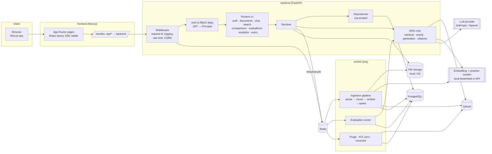
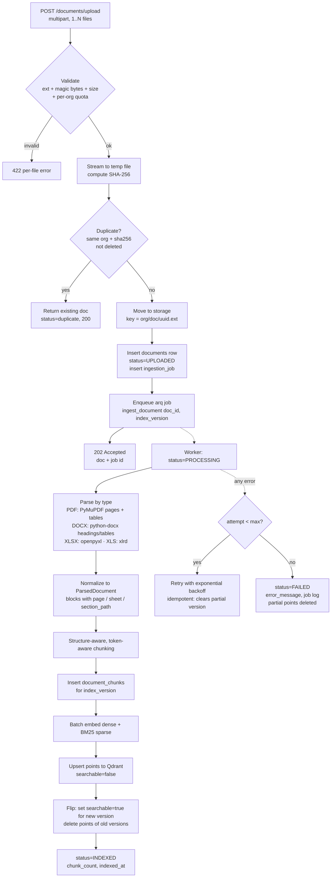
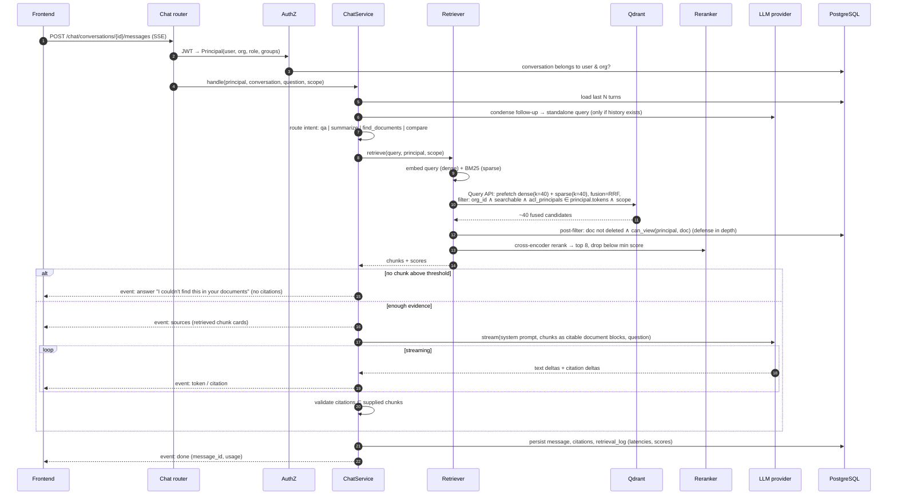
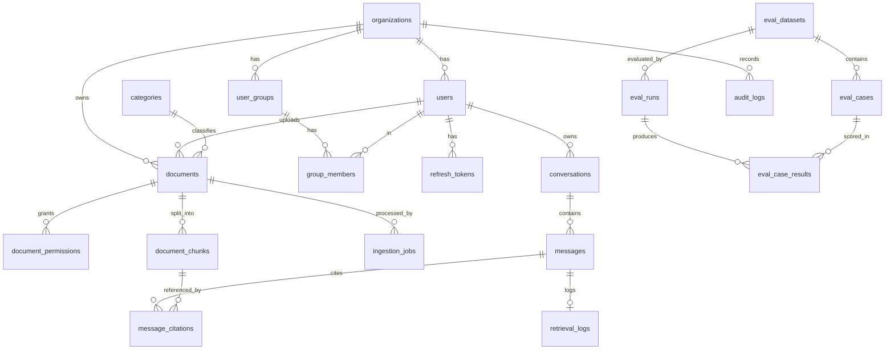

# DocuMind — Phase 1: Architecture & Design

> Status: **Draft for approval**. Nothing in this document is implemented yet.
> Scope: Enterprise Document Intelligence Platform (upload → index → RAG chat with citations → comparison → analytics → evaluation).

---

## 0. Key decisions at a glance

| Concern | Decision | Why |
|---|---|---|
| API | FastAPI (async), Pydantic v2, SQLAlchemy 2.0 async + asyncpg, Alembic | Async end-to-end; typed contracts; OpenAPI for free |
| Background jobs | **arq** workers on **Redis** | Async-native (shares the same async services/repositories as the API), retries + backoff, small footprint. Redis also backs rate limiting and SSE cancellation flags |
| Relational store | PostgreSQL 16 — **system of record** (users, docs, ACLs, chunks text, conversations, evals, audit) | Qdrant is treated as a rebuildable index, never the source of truth |
| Vector store | Qdrant — one collection per *embedding config*, accessed through an alias | Lets us re-embed / re-chunk side by side and switch atomically (needed for eval regression) |
| Hybrid search | Qdrant **named dense + sparse (BM25) vectors** on the same point, fused with **RRF** via the Query API | Keyword + semantic in one round trip, one ACL filter, no PG↔Qdrant sync for full-text |
| Embeddings | Pluggable `EmbeddingProvider`. Default: local `BAAI/bge-base-en-v1.5` via fastembed (768-d); OpenAI/Voyage selectable by config | Runs with zero extra API keys; swap without code changes |
| Reranking | Pluggable `Reranker`. Default: local cross-encoder `BAAI/bge-reranker-base`; Cohere optional | Large precision gain on top-K at low cost |
| LLM | Pluggable `LLMProvider`. Default: Anthropic **`claude-opus-5-5`** via the official `anthropic` SDK, streaming, adaptive thinking; OpenAI adapter behind the same interface | Claude's native **Citations** feature ties every citation to a block we supplied → citations cannot reference text we didn't retrieve |
| Orchestration | LangChain used where it adds value: loaders/text splitters, prompt templates. Retrieval & generation are thin in-house services | Avoids framework lock-in on the security-critical path (ACL filtering, citation validation) |
| File storage | `StorageBackend` interface: local volume (dev) / S3-compatible (MinIO/S3 in prod) | Original files never served from a public path |
| Frontend | Next.js (App Router, TS), Tailwind, shadcn/ui, Lucide, TanStack Query, Recharts | As specified |
| Auth | Argon2id passwords; JWT access token (15 min, in memory) + rotating refresh token (7 d, httpOnly cookie, hashed in PG) | Refresh-token reuse detection; no tokens in localStorage |

---

## 1. System architecture

### 1.1 Components & responsibilities

| Component | Responsibility | Does **not** do |
|---|---|---|
| **Next.js frontend** | UI, routing, auth session handling (access token in memory, silent refresh), React Query cache, SSE stream rendering | Any authorization decision; never sees API keys |
| **Next.js rewrite proxy** | `/api/*` → FastAPI, so the browser stays same-origin (simple cookie handling, no CORS for the app) | Business logic |
| **FastAPI API** (`app/api`) | HTTP contracts, validation, authN (JWT), authZ (RBAC + document ACL), rate limiting, SSE streaming, OpenAPI | Long-running parsing/embedding |
| **Services** (`app/services`) | Use-case logic: DocumentService, ChatService, SearchService, ComparisonService, EvaluationService, AnalyticsService, AuthService | Direct SQL (goes through repositories) |
| **Repositories** (`app/repositories`) | All SQLAlchemy queries; **every query is org-scoped by construction** (`OrgScopedRepository` requires `org_id`) | Business rules |
| **RAG package** (`app/rag`) | ingestion (parsers), chunking, embeddings, retrieval, reranking, generation, evaluation — each behind a small protocol | HTTP or DB-session management |
| **arq worker** (`app/workers`) | Ingestion jobs, reprocess, vector purge on delete, ACL payload sync, evaluation runs, reconciliation | Serving requests |
| **PostgreSQL** | System of record incl. chunk text (so Qdrant can be rebuilt) | Vector search |
| **Qdrant** | Dense+sparse vectors, payload filters for tenant/ACL/searchability | Being the source of truth for permissions |
| **Redis** | arq queue, rate-limit counters, stream-cancel flags, short-lived caches | Durable data |
| **LLM API** (Anthropic / OpenAI) | Answer generation, query condensation, LLM-as-judge in evals | Receiving anything beyond the minimum retrieved context |

### 1.2 Architecture diagram



### 1.3 Backend layering

```
api (routers, deps)  →  services  →  repositories  →  db (SQLAlchemy models)
                           ↓
                          rag (providers via protocols, injected from core/config)
```

Provider swapping is done with small `typing.Protocol` interfaces and a factory reading settings:

```python
class EmbeddingProvider(Protocol):
    model_id: str; dim: int
    async def embed_documents(self, texts: list[str]) -> list[list[float]]: ...
    async def embed_query(self, text: str) -> list[float]: ...

class SparseEncoder(Protocol):      # BM25
    def encode(self, texts: list[str]) -> list[SparseVector]: ...

class VectorStore(Protocol):        # Qdrant implementation; others possible
    async def upsert(...); async def hybrid_query(...); async def set_payload(...); async def delete(...)

class Reranker(Protocol):
    async def rerank(self, query: str, candidates: list[Candidate], top_n: int) -> list[Candidate]: ...

class LLMProvider(Protocol):
    async def stream_grounded_answer(self, req: GroundedRequest) -> AsyncIterator[GenerationEvent]: ...
    async def complete_json(self, prompt: str, schema: type[BaseModel]) -> BaseModel: ...  # judge, condensation
```

---

## 2. Document ingestion pipeline

### 2.1 Flow



### 2.2 Details

**Validation.** Extension allow-list (`.pdf .docx .xlsx .xls`) **and** magic-byte sniffing (`%PDF`, ZIP container with `word/` or `xl/` parts, OLE2 for `.xls`). Max size configurable (default 50 MB/file, 20 files/request). Files are streamed to disk in chunks — never fully buffered in memory. Macro-enabled formats are rejected. ZIP-bomb guard: cap total uncompressed size for OOXML.

**Parsing → `ParsedDocument`.** Each parser returns a list of `Block(text, kind=paragraph|heading|table|sheet_rows, page, sheet, section_path, bbox?)` plus document metadata (title, author, created/modified dates, page_count, sheet names).
- **PDF (PyMuPDF):** per-page text with layout order; `page.find_tables()` → tables rendered as Markdown; heading detection from font-size heuristics for `section_path`. Pages with almost no text are flagged `needs_ocr` (OCR is a stretch goal; the document is still indexed with what exists and the UI shows a warning).
- **DOCX (python-docx):** walk body in order; `Heading N` styles build `section_path` ("Security > Access Control"); tables → Markdown. No page numbers in DOCX (they're a rendering artifact) → citations use section instead.
- **XLSX/XLS:** per sheet, detect header row, emit rows as `col: value` records; computed values (not formulas) via `data_only=True`; hidden sheets included but flagged; very large sheets capped with a warning.

**Chunking (configurable per org/eval config).**
1. Never cross a hard boundary: page (PDF), top-level section (DOCX), sheet (Excel).
2. Within a boundary, LangChain `RecursiveCharacterTextSplitter.from_huggingface_tokenizer` using the **embedding model's tokenizer** — sizes are true token counts for the model that embeds them. Defaults: `chunk_size=512` tokens, `chunk_overlap=64`.
3. Tables are kept whole if ≤ `chunk_size`, else split by row groups with the **header row repeated** in each chunk.
4. Excel: groups of N rows per chunk with header repeated and `sheet_name` + row range in metadata.
5. Each chunk is prefixed (for embedding only) with a short context header: `Document: <title> | Section: <path> | Sheet: <name>` — improves retrieval of out-of-context chunks. The stored `text` used for display/citation is the raw chunk.

**Idempotency & searchability.** Every ingestion run writes under a new `index_version`. Points are upserted with `searchable=false`; only after *all* points are written does the worker flip them to `true` and delete older versions — a half-indexed document can never be retrieved, and reprocessing never makes a document temporarily unsearchable. Point IDs are deterministic UUIDv5(`doc_id`, `index_version`, `chunk_index`) so a retried job overwrites rather than duplicates.

**Duplicates.** `UNIQUE (organization_id, sha256) WHERE deleted_at IS NULL`. Re-uploading identical bytes returns the existing document (UI: "Already uploaded as …"). Same name/different bytes is a new document.

**Deletion.** Soft delete in PG (immediately excluded from listings and from the retrieval post-filter) → set Qdrant `searchable=false` synchronously by filter (fast) → worker purges points, chunks, and the stored file. A periodic **reconciliation job** compares PG and Qdrant counts per document and repairs drift.

**Retries.** arq `max_tries=3` with exponential backoff; parsing errors that are deterministic (corrupt file, encrypted PDF) fail immediately without retrying. Every attempt is recorded in `ingestion_jobs` with stage and timings.

---

## 3. RAG retrieval & generation pipeline

### 3.1 Flow



### 3.2 Details

**Query condensation.** Follow-ups ("what about the second one?") are rewritten into a standalone query using the last few turns. The original question is still what the user sees and what goes to the final answer prompt.

**Intent routing** (cheap structured-output classification, with a rules fallback):
- `qa` → standard pipeline above.
- `summarize` (a specific document) → retrieval is the wrong tool for "summarize X". Use **map-reduce over all chunks of that document** (chunked summaries, then a final summary), citing the sections each summary point comes from.
- `find_documents` ("which documents mention Kubernetes?") → Qdrant `query_points_groups` grouped by `document_id`, returning a document list with best-matching snippet each.
- `compare` → see §3.4.

**Hybrid retrieval.** Each point has two named vectors: `dense` (cosine) and `bm25` (sparse, IDF modifier on the collection). One Query API call with two `prefetch` branches and `fusion: rrf`. The ACL/tenant filter is applied **inside each prefetch**, so unauthorized points are never candidates (not filtered after the fact).

**Reranking.** Cross-encoder scores (query, chunk) pairs for the ~40 fused candidates; keep top `n=8` with a minimum relevance threshold. Per-document diversity cap (max 4 chunks from one document unless the scope is a single document).

**Context construction.** Chunks are ordered by document then position, de-duplicated by overlap, and fitted to a token budget. Each chunk becomes one citable unit with a title like `Q3 Financial Report.pdf — p. 12 — Revenue`.

**Generation (Anthropic default).**
- Model `claude-opus-5-5` (configurable via `LLM_MODEL`), streaming via `client.messages.stream(...)`, `thinking: {type: "adaptive"}`, `output_config.effort` configurable (default `medium` for chat).
- Each retrieved chunk is passed as a **`document` content block with custom content and `citations: {enabled: true}`**. Claude's response then contains citation objects that reference the block index we supplied, which maps 1:1 to our `chunk_id`. A citation can only point at text we actually retrieved.
- The static system prompt is cached (`cache_control`) to cut cost/latency.
- `stop_reason == "refusal"` is handled explicitly; the server-side refusal fallback (`fallbacks: "default"`) is enabled by default and can be turned off by config.
- OpenAI adapter: same interface; chunks are numbered `[S1]…[Sn]` and the model must cite markers. Our validator maps markers back to chunks.

**Citation validation (provider-independent).** After generation, each citation must (a) reference a chunk we supplied in this turn and (b) its quoted text must occur in that chunk (fuzzy match ≥ 0.9). Invalid citations are dropped and logged as a quality signal. Citations are persisted with a **snippet snapshot** so history still renders even if the document is later deleted (the link then shows "document no longer available").

**Facts vs. interpretation.** The system prompt requires the answer to separate *document-grounded statements* (always cited) from *analysis/inference* (explicitly labelled, e.g. a final "Interpretation" section, uncited). The UI renders the two differently. If evidence is insufficient the model must say so; additionally, when retrieval returns nothing above threshold we **don't call the LLM at all**.

**Prompt-injection defenses.** Retrieved text is delivered as document content (data), never concatenated into the system prompt; the system prompt states that instructions inside documents must be ignored; the generation call has **no tools**, so an injected instruction cannot trigger actions; ingestion flags chunks matching injection heuristics (`ignore previous instructions`, role-play markers, hidden-text in PDFs) in payload `flags` for monitoring; output is rendered as sanitized Markdown (no raw HTML) so injected links/scripts can't execute.

### 3.3 Citation object (API contract)

```json
{
  "index": 1,
  "chunk_id": "6f1c…",
  "document_id": "a9e2…",
  "document_title": "Security Policy v3.docx",
  "page": null,
  "page_end": null,
  "sheet": null,
  "section": "Access Control > Passwords",
  "snippet": "Passwords must be rotated every 90 days…",
  "score": 0.87,
  "url": "/documents/a9e2…?chunk=6f1c…#section"
}
```
Clicking opens the document viewer: PDFs at `#page=N` with the snippet highlighted; DOCX/Excel open the extracted-text view scrolled to the chunk (section / sheet + row range).

### 3.4 Document comparison

User selects 2–N documents (each must pass `can_view`). The aspects to compare come from the user question or, if generic ("compare these"), from a structure pass over each document's section titles. For each aspect, retrieval runs **per document with its own budget** (so one large document can't crowd out the others), then one generation call returns **structured output** (validated with Pydantic):

```json
{ "aspects": [ { "aspect": "Data retention",
    "per_document": [ { "document_id": "…", "finding": "…", "citations": [ … ], "status": "present|absent|unclear" } ],
    "difference_summary": "…", "conflict": true } ],
  "missing_or_inconsistent": [ … ], "overall_summary": "…" }
```
Rendered as a comparison table (aspect rows × document columns) with citations per cell.

---

## 4. PostgreSQL schema

All PKs are UUIDv7 (time-ordered, index-friendly). All tenant tables carry `organization_id` with a composite index leading on it. Timestamps are `timestamptz`.



### 4.1 Tables

**Identity & tenancy**

| Table | Columns (key ones) | Constraints / indexes |
|---|---|---|
| `organizations` | id, name, slug, settings jsonb (chunking, retrieval, quotas), storage_quota_bytes, created_at | `slug` unique |
| `users` | id, organization_id, email (citext), password_hash, full_name, role (`admin`\|`manager`\|`user`), is_active, last_login_at, created_at, updated_at | `email` unique; idx (organization_id, role) |
| `refresh_tokens` | id, user_id, token_hash (sha256), family_id, expires_at, revoked_at, replaced_by_id, user_agent, ip, created_at | idx token_hash; reuse of a revoked token revokes the whole family |
| `user_groups` | id, organization_id, name, description | unique (organization_id, name) |
| `group_members` | group_id, user_id | PK (group_id, user_id) |

**Documents**

| Table | Columns | Constraints / indexes |
|---|---|---|
| `categories` | id, organization_id, name, color | unique (organization_id, name) |
| `documents` | id, organization_id, owner_id, category_id?, title, original_filename, mime_type, file_ext, size_bytes, sha256, storage_key, status (`uploaded`\|`processing`\|`indexed`\|`failed`), visibility (`private`\|`organization`\|`restricted`), active_index_version int, chunk_count, page_count?, sheet_names text[]?, metadata jsonb (author, created, modified, warnings), embedding_config_id, error_message?, created_at, updated_at, indexed_at?, deleted_at? | **unique (organization_id, sha256) where deleted_at is null**; idx (organization_id, status), (organization_id, created_at desc), (organization_id, category_id); trigram/GIN on title for search |
| `document_permissions` | id, document_id, principal_type (`user`\|`group`), principal_id, permission (`view`\|`manage`), granted_by, created_at | unique (document_id, principal_type, principal_id) |
| `ingestion_jobs` | id, document_id, index_version, status (`queued`\|`running`\|`succeeded`\|`failed`), attempt, stage (`parse`\|`chunk`\|`embed`\|`upsert`\|`finalize`), error?, metrics jsonb (timings, token counts), started_at, finished_at | idx (document_id, created_at desc) |
| `document_chunks` | id (= Qdrant point id), document_id, organization_id, index_version, chunk_index, text, token_count, page_start?, page_end?, sheet_name?, row_start?, row_end?, section_path?, content_hash, flags text[] | unique (document_id, index_version, chunk_index); idx (organization_id) |
| `embedding_configs` | id, name, embedding_provider, embedding_model, dim, sparse_model, chunk_size, chunk_overlap, qdrant_collection, is_active, created_at | one active per deployment; the basis of re-index & regression runs |

**Conversations**

| Table | Columns | Notes |
|---|---|---|
| `conversations` | id, organization_id, user_id, title, scope jsonb (`{document_ids?, category_ids?}`), created_at, updated_at, deleted_at? | Owner-only (admins can't read others' chats by default — privacy) |
| `messages` | id, conversation_id, role (`user`\|`assistant`), content, status (`streaming`\|`complete`\|`error`\|`cancelled`), intent?, model?, usage jsonb (input/output/cache tokens), latency_ms?, created_at | idx (conversation_id, created_at) |
| `message_citations` | id, message_id, citation_index, chunk_id? (nullable: chunk may be purged), document_id?, document_title, page?, sheet?, section?, snippet, score | Snapshot so history survives deletions |
| `document_comparisons` | id, organization_id, user_id, document_ids uuid[], question, result jsonb, status, created_at | |

**Observability & analytics**

| Table | Columns | Notes |
|---|---|---|
| `retrieval_logs` | id, organization_id, user_id, message_id?, mode (`semantic`\|`hybrid`), query_hash, top_k, candidate_count, returned_chunk_ids uuid[], top_score, no_answer bool, latency jsonb (`embed, search, rerank, llm_first_token, llm_total`), embedding_config_id, created_at | Query text stored only in `messages`, never in app logs; idx (organization_id, created_at) |
| `audit_logs` | id, organization_id, actor_id?, action (`auth.login`, `document.delete`, `permission.grant`, `user.role_change`, …), resource_type, resource_id, ip, user_agent, details jsonb, created_at | Append-only (no UPDATE/DELETE grant for the app role) |

**Evaluation**

| Table | Columns | Notes |
|---|---|---|
| `eval_datasets` | id, organization_id, name, description, created_by, created_at | |
| `eval_cases` | id, dataset_id, question, expected_answer, relevant_document_ids uuid[], relevant_chunk_ids uuid[], evidence jsonb (`[{document_id, page?, section?, quote}]`), tags text[] | `evidence` makes ground truth survive re-chunking (see §10) |
| `eval_runs` | id, dataset_id, status, config_snapshot jsonb (embedding config, chunking, top_k, fusion, reranker, LLM model/effort, prompt version, git sha), baseline_run_id?, aggregate_metrics jsonb, started_at, finished_at, triggered_by | |
| `eval_case_results` | id, run_id, case_id, retrieved_chunk_ids uuid[], answer, citations jsonb, metrics jsonb (`p@k, r@k, mrr, ndcg, faithfulness, answer_relevance, context_relevance, citation_accuracy, hallucination`), judge_rationale jsonb, latency_ms, cost_usd | |

---

## 5. Qdrant collection & payload design

**Collection naming:** `chunks__{embedding_config_name}` (e.g. `chunks__bge-base-512-64`), with alias **`chunks_active`** pointing at the live one. Re-embedding or re-chunking builds a new collection in the background; switching is an atomic alias swap; eval runs can target any collection explicitly.

**Vectors:**
```json
{
  "vectors":        { "dense": { "size": 768, "distance": "Cosine", "on_disk": true } },
  "sparse_vectors": { "bm25":  { "modifier": "idf" } },
  "hnsw_config":    { "payload_m": 16, "m": 0 },
  "quantization_config": { "scalar": { "type": "int8", "always_ram": true } }
}
```
`m: 0` + `payload_m: 16` builds the HNSW graph **per tenant** (multitenancy pattern), so filtered search inside one org stays fast and accurate.

**Payload (per point):**
```json
{
  "org_id": "uuid",
  "document_id": "uuid",
  "index_version": 3,
  "chunk_id": "uuid",
  "chunk_index": 17,
  "searchable": true,
  "acl": ["admin:<org_id>", "user:<org_id>:<owner_uid>", "org:<org_id>", "group:<org_id>:<gid>"],
  "category_id": "uuid|null",
  "file_type": "pdf|docx|xlsx|xls",
  "document_title": "Q3 Financial Report.pdf",
  "page_start": 12, "page_end": 12,
  "sheet_name": null, "row_start": null, "row_end": null,
  "section_path": "Revenue > Regional",
  "text": "…raw chunk text…",
  "token_count": 412,
  "content_hash": "sha256",
  "flags": [],
  "created_at": "2026-11-06T10:00:00Z"
}
```

ACL tokens are organization-qualified, so they can never match across tenants even without the `org_id` condition (implemented in `app/services/access_policy.py`; equivalence with the Python policy is tested exhaustively).

**Payload indexes:** `org_id` (keyword, `is_tenant: true`), `document_id` (keyword), `acl` (keyword), `searchable` (bool), `category_id` (keyword), `file_type` (keyword), `created_at` (datetime).

**Standard retrieval filter:**
```json
{ "must": [
    { "key": "org_id",     "match": { "value": "<org>" } },
    { "key": "searchable", "match": { "value": true } },
    { "key": "acl",        "match": { "any": ["org:<org>", "user:<org>:<uid>", "group:<org>:<g1>", "admin:<org> (admins only)"] } }
  ],
  "must_not": [],
  "should": []
}
```
plus optional `document_id ∈ scope` / `category_id ∈ …` from the conversation scope.

---

## 6. RBAC & document permission strategy

### 6.1 Roles (org-scoped)

| Capability | Admin | Manager | User |
|---|:-:|:-:|:-:|
| Manage users, roles, groups | ✅ | — | — |
| Org settings, embedding configs, re-index | ✅ | — | — |
| Upload documents | ✅ | ✅ | config flag (default off) |
| Edit/delete/reprocess/share a document | ✅ any | ✅ own + docs granted `manage` | docs granted `manage` |
| View document / retrieve its chunks | ✅ all in org | per ACL | per ACL |
| Chat, search, compare | ✅ | ✅ | ✅ (over authorized docs only) |
| Evaluations (run/manage) | ✅ | view | — |
| Analytics | ✅ org-wide | ✅ own/managed docs | own usage only |
| Audit log | ✅ | — | — |

Roles map to **permissions strings** (`documents:upload`, `users:manage`, `evaluations:run`, …) checked by a FastAPI dependency: `Depends(require_permission("documents:upload"))`. Endpoints never check role names directly.

### 6.2 Document-level access

A principal can **view** a document iff it's in the same org **and** one of:
- principal is Admin, or the owner;
- `visibility = organization`;
- `visibility = restricted` and a `document_permissions` row grants the user or one of the user's groups.

`private` = owner (+ admins) only. **Manage** requires owner, Admin, or an explicit `manage` grant.

### 6.3 Enforcement in three layers (never only the frontend)

1. **API layer:** `get_principal` dependency decodes JWT → loads user (active check) → `Principal(user_id, org_id, role, group_ids, permissions)`. Document endpoints call a single `DocumentAccessPolicy.can_view/can_manage`. Lookups of another org's IDs return **404, not 403** (no existence leak).
2. **Repository layer:** all repositories require `org_id`; there is no unscoped query method. A `visible_documents(principal)` SQL predicate is reused by listings, search, analytics.
3. **Retrieval layer:** the Qdrant filter is built **only** from the server-side `Principal` (never from request params) and applied inside the vector search. Then a **PG post-check** of the top candidates (`can_view` on their document IDs, not deleted) — a stale payload can only ever make results *narrower*, never leak.

**ACL sync.** On share/unshare, visibility change, group membership change or user deactivation, the service writes PG in a transaction and enqueues an `acl_sync` job that recomputes `acl` for affected documents via `set_payload` by `document_id` filter. Revocations also take effect **immediately** thanks to the PG post-check, even before the payload sync runs.

**Conversations** are owner-only; each new message re-evaluates permissions, so a document revoked mid-conversation stops appearing in subsequent answers. Previously stored citation snippets remain in that user's own history (they were authorized at the time); if your policy requires redaction on revocation, we can hide snippets for now-unauthorized documents at read time — see open questions.

---

## 7. API design (v1)

Conventions: JSON; `Authorization: Bearer <access>`; errors `{"error": {"code": "document_not_found", "message": "...", "details": {...}, "request_id": "..."}}`; list endpoints `?page=&page_size=` (max 100) returning `{items, total, page, page_size}`; timestamps ISO-8601 UTC; all IDs UUID. Rate limits per user + per IP (stricter on auth and chat). OpenAPI at `/docs`, `/openapi.json`.

### Auth
| Method | Path | Body / notes | Auth |
|---|---|---|---|
| POST | `/api/v1/auth/register` | `{email, password, full_name, organization_name}` → creates org + Admin. (Joining existing orgs is via admin invite.) | public, rate-limited |
| POST | `/api/v1/auth/login` | `{email, password}` → `{access_token, expires_in, user}`; sets `refresh_token` httpOnly/Secure/SameSite=Strict cookie | public, rate-limited, lockout on brute force |
| POST | `/api/v1/auth/refresh` | cookie → new access + rotated refresh | cookie |
| POST | `/api/v1/auth/logout` | revokes refresh family, clears cookie | any |
| GET | `/api/v1/auth/me` | current user, org, role, permissions | user |
| POST | `/api/v1/auth/change-password` | `{current_password, new_password}` | user |

### Users & groups (Admin)
| Method | Path | Notes |
|---|---|---|
| GET/POST | `/api/v1/users` | list / invite (create with temp password or invite token) |
| GET/PATCH/DELETE | `/api/v1/users/{user_id}` | role change, deactivate (audited) |
| GET/POST | `/api/v1/groups` · PATCH/DELETE `/groups/{id}` · PUT `/groups/{id}/members` | |

### Documents
| Method | Path | Notes |
|---|---|---|
| POST | `/api/v1/documents/upload` | multipart `files[]`, optional `category_id`, `visibility` → 202 `{results: [{filename, status: accepted\|duplicate\|rejected, document?, error?}]}` |
| GET | `/api/v1/documents` | filters `q, status, category_id, file_type, owner, date_from, date_to`, sort |
| GET | `/api/v1/documents/{id}` | metadata + latest job + permissions summary |
| PATCH | `/api/v1/documents/{id}` | title, category, visibility (manage) |
| DELETE | `/api/v1/documents/{id}` | soft delete + async purge (manage) → 202 |
| POST | `/api/v1/documents/{id}/reprocess` | new index_version (manage) → 202 |
| GET | `/api/v1/documents/{id}/download` | streams original, `Content-Disposition: attachment` (view) |
| GET | `/api/v1/documents/{id}/preview` | PDF inline stream; DOCX/Excel → extracted structured text for viewer |
| GET | `/api/v1/documents/{id}/chunks` | paginated chunks (citation deep-link target, eval labeling) |
| GET | `/api/v1/documents/{id}/jobs` | ingestion history |
| GET/PUT | `/api/v1/documents/{id}/permissions` | list / replace grants (manage) |
| GET/POST/PATCH/DELETE | `/api/v1/categories[/{id}]` | |

### Chat
| Method | Path | Notes |
|---|---|---|
| POST | `/api/v1/chat/conversations` | `{title?, scope?}` |
| GET | `/api/v1/chat/conversations` | own conversations, newest first |
| GET | `/api/v1/chat/conversations/{id}` | with messages + citations |
| PATCH | `/api/v1/chat/conversations/{id}` | rename, change scope |
| DELETE | `/api/v1/chat/conversations/{id}` | soft delete |
| POST | `/api/v1/chat/conversations/{id}/messages` | `{content, scope_override?}`; `Accept: text/event-stream` → SSE; otherwise JSON once complete |
| POST | `/api/v1/chat/conversations/{id}/messages/{mid}/cancel` | stop generation |
| GET | `/api/v1/chat/suggestions` | suggested questions derived from recent authorized documents' titles/sections |

**SSE events:** `meta {message_id, intent}` → `sources {chunks[]}` → `token {text}`* → `citation {citation}`* → `done {usage, latency_ms}` | `error {code, message}`.

### Comparisons
| POST | `/api/v1/comparisons` | `{document_ids[2..5], question?}` → SSE progress + final structured result |
|---|---|---|
| GET | `/api/v1/comparisons` · `/comparisons/{id}` | history |

### Search
| Method | Path | Body |
|---|---|---|
| POST | `/api/v1/search/semantic` | `{query, top_k≤50, filters{document_ids, category_ids, file_types}, rerank?: bool}` → `{results: [{chunk, document, score}]}` |
| POST | `/api/v1/search/hybrid` | same + `{fusion: rrf, dense_k, sparse_k}` |
| POST | `/api/v1/search/documents` | document-level results (grouped) for "find documents mentioning X" |

### Evaluations (Admin; Manager read)
| Method | Path | Notes |
|---|---|---|
| GET/POST | `/api/v1/evaluations/datasets` · GET/PATCH/DELETE `/datasets/{id}` | |
| GET/POST | `/api/v1/evaluations/datasets/{id}/cases` · PATCH/DELETE `/cases/{id}` · POST `/datasets/{id}/import` (JSONL) | |
| POST | `/api/v1/evaluations/run` | `{dataset_id, config_overrides?, baseline_run_id?, k: 5}` → 202 run |
| GET | `/api/v1/evaluations/results` | runs list; `/results/{run_id}` with per-case results and diff vs baseline |
| GET | `/api/v1/evaluations/metrics` | time series of aggregate metrics per dataset/config |

### Analytics
| GET | `/api/v1/analytics/overview` | totals: documents, indexed, failed, chunks, conversations, storage bytes, queries (7d) |
|---|---|---|
| GET | `/api/v1/analytics/documents` | `?from&to&interval=day` uploads/indexed/failed series, by type/category, recent activity |
| GET | `/api/v1/analytics/retrieval` | latency p50/p95 by stage, no-answer rate, avg top score, citation drop rate, tokens/cost |

### Ops
`GET /health` (liveness), `GET /ready` (PG, Qdrant, Redis reachable).

---

## 8. How the components communicate

| From → To | Protocol | Notes |
|---|---|---|
| Browser → Next.js | HTTPS | Pages + static assets |
| Next.js → FastAPI | HTTP via `rewrites` (`/api/*`) | Same-origin for the browser; refresh cookie is first-party. Proxy buffering disabled for SSE |
| Frontend data layer | TanStack Query + typed fetch client generated from OpenAPI (`openapi-typescript`) | Polling `GET /documents?status=processing` every 3 s while any doc is processing (simple, reliable); SSE for chat |
| Streaming chat | `fetch` POST + `ReadableStream` SSE parser | `EventSource` can't POST or send `Authorization` |
| FastAPI → PostgreSQL | asyncpg via SQLAlchemy async, pooled | Request-scoped `AsyncSession`, unit-of-work per request |
| FastAPI/worker → Qdrant | `qdrant-client` AsyncQdrantClient (gRPC) | API key in prod |
| FastAPI → Redis | `redis.asyncio` | enqueue arq jobs, rate limits, cancel flags |
| Worker ↔ Redis | arq | job payload = IDs only (never document content) |
| Backend → LLM | `anthropic` SDK (HTTPS, streaming) / `openai` SDK | Keys only in backend env; timeouts + retries; per-org token accounting |
| Backend → embedding/reranker | in-process ONNX (fastembed) or provider SDK | Models cached in a volume |
| Backend → storage | filesystem / S3 API | Signed internal access only; downloads streamed through the API after authZ |

Docker Compose services: `frontend`, `backend`, `worker`, `postgres`, `qdrant`, `redis` (+ optional `minio`). Config via environment (`pydantic-settings`), `.env.example` documents every variable; secrets never baked into images.

---

## 9. Security & production readiness (summary)

- Argon2id (`pwdlib`), password policy, login throttling + temporary lockout.
- JWT HS256/RS256 with `iss`, `aud`, `exp`, `jti`, `org`, `role` claims; role/active status re-checked from DB per request (cheap, cached 30 s) so deactivation is immediate.
- Refresh-token rotation with reuse detection; logout revokes the family.
- Rate limiting (Redis sliding window): auth, upload, chat, search separately.
- Upload hardening: allow-list + magic bytes + size + ZIP-bomb guard; files stored under random keys outside any web root; served only via authorized streaming with `Content-Disposition` and `X-Content-Type-Options: nosniff`.
- Structured JSON logging (structlog) with request IDs; **redaction** — no document text, prompts, tokens, or passwords in logs.
- Audit logs for: login/logout/failed login, user & role changes, uploads, deletes, reprocess, permission changes, downloads, evaluation runs, settings changes.
- Security headers (CSP, HSTS in prod), CORS locked to the frontend origin.
- Prompt-injection defenses as in §3.2.
- Tests explicitly covering cross-tenant and cross-user leakage at the API **and** retrieval layers.

---

## 10. Evaluation module design

**Ground truth that survives re-chunking.** Chunk IDs change whenever chunking changes, which would invalidate a chunk-ID-only dataset. Each case stores `relevant_document_ids`, optional `relevant_chunk_ids` (valid for one embedding config), and `evidence` quotes (`{document_id, page/section, quote}`). At run time, evidence quotes are resolved to the chunks *of the config under test* by text containment/overlap → per-config relevance labels. A labeling UI lets admins pick chunks from search results to create cases.

**Metrics.**
- Retrieval (deterministic, own code, unit-tested against hand-computed examples): Precision@K, Recall@K, MRR, NDCG@K (binary or graded relevance), plus document-level hit rate.
- Answer quality (LLM-as-judge with structured outputs and fixed, versioned rubrics; temperature-free models so we run each judge once and record rationale):
  - *Faithfulness* — claims extracted from the answer; fraction supported by the provided context.
  - *Answer relevance* — does it address the question (1–5, normalized).
  - *Context relevance* — fraction of retrieved chunks relevant to the question.
  - *Citation accuracy* — fraction of citations whose cited chunk supports the sentence it's attached to (+ fraction of cited chunks in the ground-truth set).
  - *Hallucination rate* — unsupported factual claims / total claims; plus "should have abstained" detection for unanswerable cases.
  - *Answer correctness* vs. `expected_answer` (semantic agreement).
- Ops: latency per stage, tokens, cost per case.

**Runner.** arq job iterates cases with bounded concurrency, uses the **same retrieval/generation code path** as chat (with a synthetic principal scoped to the dataset's documents), stores per-case results and aggregates, and compares to a baseline run. A CLI (`python -m app.rag.evaluation.run --dataset … --fail-under ndcg=0.70 --max-drop 0.03`) enables CI regression gating when embedding model, chunking, retrieval config, prompts or LLM change. The dashboard shows metric trends per config and per-case diffs (regressions highlighted).

---

## 11. Technical challenges & recommended solutions

| # | Challenge | Recommended solution |
|---|---|---|
| 1 | **Leakage across tenants/users** | Filter inside vector search from server-side principal + PG post-check; org-scoped repositories; 404 for foreign IDs; dedicated leakage test suite |
| 2 | ACL changes vs. denormalized Qdrant payload | PG is truth; post-check makes revocations immediate; async `set_payload` sync; nightly reconciliation |
| 3 | Partially indexed documents becoming searchable | `searchable` flag flipped only after full upsert; versioned point IDs; idempotent retries |
| 4 | PG ↔ Qdrant drift (crash between writes) | Ordered writes (PG chunks → Qdrant → flip → PG status), deterministic IDs, reconciliation job, Qdrant rebuildable from `document_chunks` |
| 5 | Scanned / image-only PDFs | Detect low-text pages, warn in UI; OCR (Tesseract/`ocrmypdf`) as an optional worker stage later |
| 6 | Tables in PDFs & huge spreadsheets | Table extraction to Markdown; header-repeating row-group chunks; caps with warnings; "extract figures" queries favor table chunks via payload `kind` |
| 7 | "Summarize this document" / "which documents mention X" don't fit top-K RAG | Intent routing: map-reduce summarization over the whole doc; grouped document search |
| 8 | Comparisons dominated by one large document | Per-document retrieval budgets; structured output per aspect |
| 9 | Follow-up questions | Query condensation from recent turns; scope carried in conversation |
| 10 | Fabricated or wrong citations | Native citation blocks (Anthropic) / marker mapping (OpenAI) + server-side quote validation; drop invalid; track drop rate as a metric |
| 11 | Answering without evidence | Rerank-score threshold → abstain without calling the LLM; prompt requires explicit "not found"; eval includes unanswerable cases |
| 12 | Prompt injection in documents | Documents as data blocks, no tools on generation, heuristic flags, sanitized rendering |
| 13 | Eval ground truth invalidated by re-chunking | Evidence-quote–based labels resolved per config |
| 14 | Changing embedding model / chunking | `embedding_configs` + collection-per-config + alias swap; background re-index; eval before switching |
| 15 | Latency (embed + search + rerank + first token) | Local ONNX models kept warm, gRPC Qdrant, int8 quantization, prompt caching, stream sources before tokens, per-stage latency logged |
| 16 | Cost control | Per-org token accounting in `messages.usage`, configurable model/effort, skip LLM on no-evidence, cache system prompt |
| 17 | SSE through proxies | `X-Accel-Buffering: no`, heartbeats every 15 s, cancel endpoint + client abort handling |
| 18 | Large uploads / memory | Streamed uploads to disk, size caps, parsing in worker only |

---

## 12. Proposed repository layout

```
backend/
  app/
    api/v1/{auth,users,groups,documents,categories,chat,comparisons,search,evaluations,analytics}.py
    api/deps.py               # get_db, get_principal, require_permission
    core/{config,security,logging,rate_limit,errors}.py
    db/{base,session}.py
    models/                   # SQLAlchemy models
    schemas/                  # Pydantic request/response
    repositories/
    services/
    rag/
      ingestion/{validators,parsers/{pdf,docx,excel},pipeline}.py
      chunking/
      embeddings/{base,fastembed,openai}.py
      retrieval/{qdrant_store,hybrid,filters}.py
      reranking/{base,cross_encoder,cohere}.py
      generation/{base,anthropic,openai,prompts,citations}.py
      evaluation/{metrics,judges,runner}.py
    workers/{settings,tasks}.py
    utils/
    main.py
  tests/{unit,integration,security,rag}/
  alembic/
  pyproject.toml / requirements.txt
  Dockerfile
frontend/
  app/(auth)/login, register · app/(dashboard)/{page,documents,embeddings,chat,evaluations,analytics,users,settings}
  components/ui (shadcn) · components/layout · features/{documents,chat,analytics,evaluations,users}
  hooks/ · lib/{api-client,auth,sse}.ts · services/ · types/ (generated from OpenAPI) · public/
infrastructure/{docker-compose.yml, qdrant/, postgres/}
docs/architecture.md
.env.example
README.md
```

---

## 13. Open questions for approval

1. **LLM provider/model:** Anthropic `claude-opus-5-5` as default (OpenAI adapter available)? Or do you want a different default model for cost reasons?
2. **Embeddings:** local `bge-base-en-v1.5` (no extra key, English-focused) vs. an API model (OpenAI / Voyage) or multilingual `bge-m3`? Are documents multilingual?
3. **Tenancy:** one organization per user (proposed) vs. users belonging to multiple workspaces?
4. **Can the `User` role upload?** Proposed: off by default, org setting.
5. **Revocation & history:** keep previously-shown citation snippets in a user's chat history after access is revoked, or redact on read?
6. **OCR for scanned PDFs:** in scope for v1 or later?
7. **Storage:** local volume for dev + S3-compatible for prod (proposed) — do you want MinIO in docker-compose from day one?
8. **Reference UI image:** it wasn't included with the prompt — please attach it before Phase 5.
